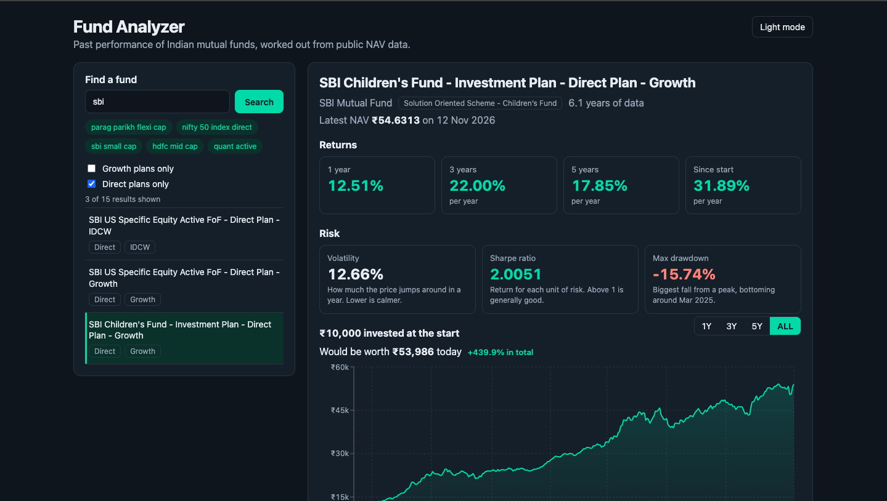
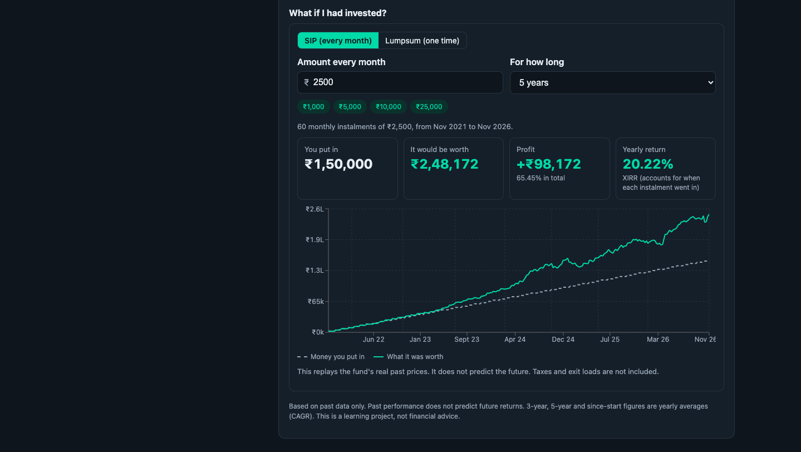
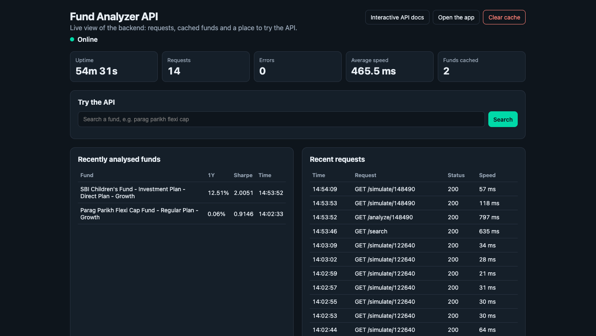
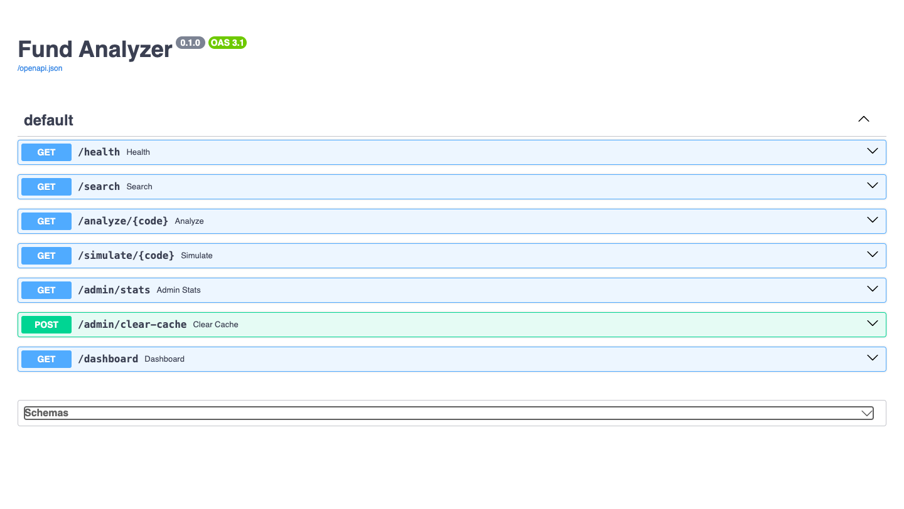
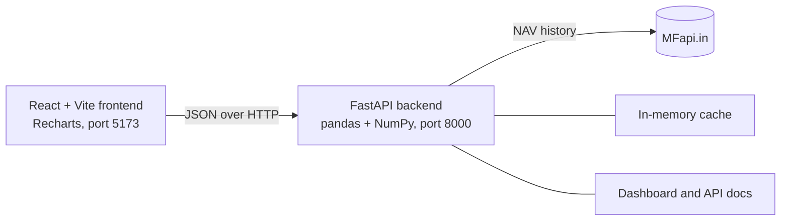

# Mutual Fund Analyzer

Analyse any Indian mutual fund from its past NAV data: returns, risk, a growth chart, and
SIP / lumpsum "what if I had invested" backtests. Full-stack project with a **FastAPI + pandas**
backend and a **React** frontend.


https://github.com/user-attachments/assets/f80f6bf1-d57d-4132-a7b7-22f902341584


## Screenshots

**Search, returns and risk**



**SIP and lumpsum calculator**



**Backend dashboard**



**Auto-generated API docs**



## Features

- Search any fund (data from [MFapi.in](https://www.mfapi.in)) with *Growth only* and *Direct only* filters
- Returns: 1-year, 3-year, 5-year and since-start (CAGR)
- Risk: annualised volatility, Sharpe ratio and maximum drawdown
- Growth-of-₹10,000 chart with 1Y / 3Y / 5Y / All periods
- SIP and lumpsum calculator that replays real past prices, with the yearly return worked out as XIRR
- Backend dashboard at `/dashboard` (uptime, request log, cached funds, try-the-API box) and auto-generated API docs at `/docs`
- Light and dark mode

## Architecture



The frontend only talks to the backend. The backend downloads a fund's NAV history once, caches it,
and does all the maths with pandas and NumPy.

## Tech stack

| Layer | Tools |
|---|---|
| Backend | Python, FastAPI, pandas, NumPy, httpx, Uvicorn |
| Frontend | React, Vite, Recharts |
| Data | MFapi.in (public mutual fund NAV API) |

## API

| Endpoint | What it does |
|---|---|
| `GET /search?q=` | Search funds by name |
| `GET /analyze/{code}` | Returns, volatility, Sharpe ratio, max drawdown and growth series for a fund |
| `GET /simulate/{code}?mode=sip\|lumpsum&amount=&years=` | Backtest a SIP or lumpsum investment on real past NAVs |
| `GET /health` | Simple health check |
| `GET /dashboard` | Live backend dashboard |
| `GET /admin/stats`, `POST /admin/clear-cache` | Data behind the dashboard |

Interactive docs are served at `/docs`.

## Run it locally

You need Python 3.9+ and Node.js 18+.

**Backend**

```bash
cd backend
python3 -m venv venv
source venv/bin/activate
pip install -r requirements.txt
uvicorn main:app --reload --port 8000
```

**Frontend** (in a second terminal)

```bash
cd frontend
npm install
npm run dev
```

**Live demo: https://priyamswain.github.io/fund-analyzer/**

## How the numbers are worked out

- **CAGR**: average yearly growth between two NAVs.
- **Volatility**: standard deviation of daily returns, scaled by the square root of 252 trading days.
- **Sharpe ratio**: (since-start CAGR minus a 6.5% assumed risk-free rate) divided by volatility.
- **Max drawdown**: the biggest fall from a previous peak.
- **SIP**: one purchase per month on the first trading day on or after each monthly date.
  **XIRR** is solved with bisection so it accounts for when each instalment went in.

## Limitations

- Everything is based on past NAV data. Past performance does not predict future returns.
- Taxes and exit loads are not included.
- The Sharpe ratio is a simple version that uses the whole-history return and a fixed risk-free rate.
- The `/admin` endpoints and dashboard have no login. They are meant for local use only.

This is a learning project, not financial advice.
